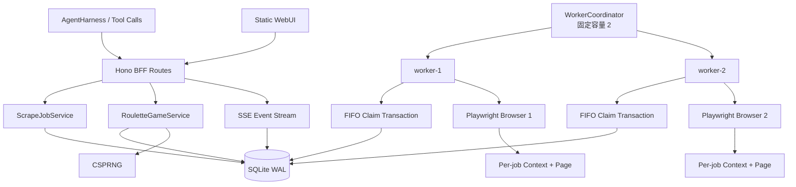
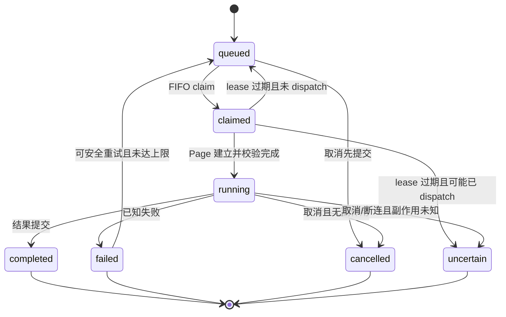

# 双 Worker Playwright Runtime 与虚拟轮盘游戏设计

日期：2026-11-17。

状态：**方案 B 为推荐方案，等待用户审阅。本文只完成设计，不包含代码、依赖安装或数据库迁移。**

## 1. 意图与成功标准

本设计在 Agent Kit 中增加一个可独立运行、可验证的公开示例 Runtime：

- BFF 主线程提供 Agent、HTTP、SSE 与静态 WebUI。
- 固定两个执行 Worker，每个 Worker 同一时刻只处理一个 Playwright 抓取任务。
- 所有抓取任务进入一个全局 FIFO 队列；前两个可执行任务由两个 Worker 分别领取，第三个必须等待任一 Worker 释放槽位。
- Agent 或 UI 可以提交、查询和取消任务，但长任务不占用 AgentHarness 的 LLM 请求窗口。
- 同一 WebUI 呈现一个独立的虚拟俄罗斯轮盘小游戏，带受控的动画、合成音效、静音与减少动态效果支持。

成功标准要求通过持久状态和真实浏览器进程证明：Worker 数不超过 2、每个 Worker 同时只有一个页面任务、任务领取顺序符合 FIFO、崩溃后不会悄悄重复有副作用的任务、游戏不会阻塞或消费抓取 Worker。

## 2. 目标、非目标与反目标

### 2.1 目标

1. 为 Playwright 抓取提供固定容量的后台执行池。
2. 用持久队列而不是内存数组保存待执行任务。
3. 在 Worker 崩溃、Runtime 重启、取消和租约超时后保持状态可解释。
4. 允许 Agent Tool 与 WebUI 使用同一组任务服务。
5. 提供可测试、可复现的虚拟轮盘规则。
6. 音视频效果与业务结果解耦；即使声音被禁用或动画失败，游戏状态仍正确。
7. 保持桌面 WebUI 简洁，并兼顾键盘、屏幕阅读器和 `prefers-reduced-motion`。

### 2.2 非目标

- 不做分布式 Worker、外部队列或跨主机调度。
- 不支持动态扩容到任意数量 Worker。
- 不在第一阶段允许用户上传或执行任意 JavaScript 抓取脚本。
- 不把游戏结果用于真实武器、金钱、博彩或现实世界风险行为。
- 不修改 `packages/core` 的 Harness、Tool Registry 或 Session 契约。
- 不为游戏建立排行榜、账号体系、多人联机或长期资产系统。
- 不修改私有 `examples/agent-runtime-bff` 子模块。

### 2.3 反目标

- 主线程直接为每个任务 `launch()` Playwright。
- 用 `Promise.all()` 制造无上限并发。
- Worker 从内存数组取任务，进程重启后任务消失。
- 只按任务状态判断可重试，而不检查浏览器是否已经开始 dispatch。
- 游戏按钮直接触发播放音频而不经过用户手势。
- 把枪声作为唯一结果反馈。
- 让游戏请求进入抓取 FIFO，或反过来让抓取阻塞游戏 API。

## 3. 当前代码基线与集成边界

当前仓库已经提供：

- `@agentkit-ai/core`：Session、AgentHarness、Tool Registry 与远端 Tool 回填。
- `@agentkit-ai/bff-hono`：Node BFF 路由与鉴权。
- `@agentkit-ai/adapter-sqlite`：SQLite Session、Pending Call 与密钥存储基础。
- `examples/browser-extension-bff`：浏览器扩展 BFF 示例。

现有 Core 没有通用后台任务队列。为避免把示例业务塞入共享包，本期新增独立的公开示例包：

```text
examples/worker-roulette-runtime/
```

该示例复用仓库已有的 TypeScript、Hono、`node:sqlite`、Vitest 与 Playwright 约定，但不改变共享包版本或公开 API。需要 Agent 调用抓取任务时，在示例内部注册 `scrape.enqueue`、`scrape.status`、`scrape.cancel` 三个 server Tool；它们只调用 `ScrapeJobService`，不直接启动浏览器。

## 4. 方案比较

### 方案 A：主线程内两个异步循环

主进程内启动两个 `while` 循环，共享 SQLite 队列，各自调用 Playwright。

优点：

- 文件少，初期实现快。
- 调试和测试直接。

缺点：

- Playwright 驱动、页面关闭清理或未捕获异常更容易影响 BFF 主线程。
- Worker 级取消、崩溃隔离和重启边界不清晰。
- 后续接入 CPU 占用高的解析或媒体处理时需要重写。

结论：只适合一次性原型，不作为目标架构。

### 方案 B：两个固定 `worker_threads` + SQLite FIFO

BFF 主线程负责 HTTP/SSE，启动两个 Worker Thread。每个 Worker 自建 SQLite 连接，用事务领取队首任务，并独立持有 Playwright Browser。

优点：

- 真实限制为两个执行槽，线程崩溃不会直接带走主 BFF。
- SQLite 是队列和状态的唯一权威，重启恢复简单。
- 不需要额外基础设施，符合当前本地单机 Runtime。
- 每个 Worker 的 Browser、Page 和取消控制器边界清楚。
- 未来可以把 Worker 内部替换为独立进程，而无需改 API 或队列语义。

缺点：

- 每个线程需要独立 SQLite 连接与 lease 心跳。
- TypeScript Worker 的构建/测试配置比单线程复杂。
- 两个 Worker 仍共享同一进程生命周期，不能提供跨主机容灾。

结论：推荐。

### 方案 C：独立进程 + 外部队列

BFF、每个 Worker 进程与消息中间件分开部署。

优点：

- 容灾和横向扩展能力最好。
- Worker 可独立滚动升级。

缺点：

- 对当前需求明显过重。
- 需要新增部署、凭据、队列运维与跨服务幂等协议。
- 不能帮助更快验证 FIFO、页面隔离或游戏交互。

结论：等出现多主机吞吐或独立发布需求后再演进。

## 5. 总体架构



### 5.1 组件职责

| 组件 | 拥有的状态 | 明确不负责 |
|---|---|---|
| `WorkerCoordinator` | 两个 Worker 的启动、退出、重启与健康投影 | 不直接抓网页，不替 Worker 写结果 |
| `ScrapeWorker` | 当前 Browser、当前 Page、当前 lease token、AbortController | 不定义全局排队规则，不服务 HTTP |
| `ScrapeJobStore` | FIFO claim、状态 CAS、lease、结果与事件事务 | 不启动浏览器，不做 HTML 解析 |
| `PlaywrightScraper` | 导航、固定 recipe 执行、结果裁剪与页面清理 | 不接受任意脚本，不决定任务重试策略 |
| `ScrapeJobService` | 提交、查询、取消和 Agent Tool 适配 | 不持有浏览器实例 |
| `RouletteGameService` | 回合、膛位、结果与幂等 shot | 不占用 Worker，不影响抓取队列 |
| `EventHub` / SSE | 按持久事件序号回放并推送 | 不作为任务状态事实来源 |
| `WebUI` | 展示队列、游戏、连接状态和本地效果设置 | 不篡改服务端结果 |

## 6. FIFO 队列与并发模型

### 6.1 容量约束

固定：

```text
workerCount = 2
jobsPerWorker = 1
maxConcurrentScrapes = 2
```

不允许通过请求参数、环境变量中的任意值或 Agent Tool 扩大并发。`worker-1` 与 `worker-2` 都由 Coordinator 管理；短暂重启时，同时活动的旧、新 Worker 合计也不得超过 2。

### 6.2 全局 FIFO 领取

每个任务拥有不可变的 `jobId`、单调递增的 `enqueueSeq` 和当前 `attempt`。Worker 每次只领取一个满足条件的最小 `enqueueSeq`：

```sql
BEGIN IMMEDIATE;
SELECT ...
FROM scrape_jobs
WHERE status = 'queued' AND available_at <= :now
ORDER BY enqueue_seq ASC
LIMIT 1;
UPDATE scrape_jobs
SET status = 'claimed', worker_id = :workerId,
    lease_token = :newLeaseToken, lease_until = :leaseUntil,
    revision = revision + 1
WHERE job_id = :jobId AND revision = :expectedRevision
  AND status = 'queued';
INSERT INTO runtime_events (...);
COMMIT;
```

`BEGIN IMMEDIATE` 让两个 Worker 的领取串行化。实际开始顺序必须遵守全局 FIFO：第三个任务不会越过仍在队列中的第一或第二任务。

任务完成时间不保证 FIFO；FIFO 只约束“开始领取”的顺序。失败后允许自动重试的任务会获得新的 `enqueueSeq`，从而排到队尾，避免一个坏任务永久堵住队首。

### 6.3 Worker 内顺序

每个 Worker 的循环固定为：

1. 事务领取任务。
2. 如 Browser 不存在，则启动 Browser。
3. 为任务创建独立 BrowserContext 与 Page。
4. 执行固定 recipe 或受限抓取声明。
5. 在结果大小和 Schema 校验通过后，事务提交结果、终态与事件。
6. `finally` 关闭 Page、Context 和取消监听器。
7. 返回领取下一任务。

同一 Worker 不允许同时保留两个业务 Page。Browser 可跨任务复用，但 Cookie、Storage、Cache 与页面上下文默认按任务隔离。

## 7. 抓取任务契约

### 7.1 API

```text
POST /api/scrape/jobs
GET  /api/scrape/jobs/:jobId
GET  /api/scrape/jobs?status=queued
POST /api/scrape/jobs/:jobId/cancel
GET  /api/events?after=<eventSeq>
```

提交请求：

```ts
interface CreateScrapeJobInput {
  url: string;
  recipeId: string;
  params: Record<string, string | number | boolean>;
  replayPolicy: 'safe_read' | 'stateful_read' | 'side_effecting';
  idempotencyKey: string;
}
```

不接受的输入：

- 任意 JavaScript 源码。
- 直接传入的 Playwright launch 参数。
- 任意代理、凭据或下载路径。
- 可提升 `workerCount`、超时或结果大小的参数。

### 7.2 Recipe

第一版提供少量代码固定的 recipe，例如：

- `page.title`
- `page.text`
- `page.links`
- `page.article`

所有选择器、导航等待和字段裁剪都由 recipe 实现，而不是由模型或前端上传函数。若以后需要页面级配置，只允许受 Schema 限制的声明式字段。

### 7.3 Agent Tools

| Tool | 行为 |
|---|---|
| `scrape.enqueue` | 创建任务，立即返回 `jobId + queuePosition` |
| `scrape.status` | 查询一个或多个任务摘要 |
| `scrape.cancel` | 请求取消；根据 dispatch 事实返回 `cancelled` 或 `uncertain` |

Tool 仅接受业务参数。`workerId`、lease、内部状态和重试次数由 Runtime 生成，不来自模型。

## 8. 任务状态机与失败语义



### 8.1 权威状态

- `scrape_jobs.status` 是当前状态唯一权威。
- `runtime_events` 是不可变审计与 SSE 回放记录。
- 内存 Worker 状态只用于健康投影，不能决定任务是否已开始。
- 所有状态写入必须携带 `worker_id + lease_token + revision` CAS；旧 Worker 的迟到结果只能写诊断事件，不能覆盖新 attempt。

### 8.2 dispatch 边界

任务在 Page 建立后，正式访问目标 URL 前，必须在同一事务中写：

```text
status = running
dispatch_started_at = now
revision = revision + 1
```

一旦 `dispatch_started_at` 已提交：

- `safe_read` 可以按配置自动重试。
- `stateful_read` 默认进入显式恢复，不自动重试。
- `side_effecting` 在取消、断连、超时或进程重启后只能进入 `uncertain`。
- “Playwright Promise 已 reject”不等于目标站点没有收到请求。

### 8.3 Lease 与恢复

- 默认 `leaseMs = 30_000`，Worker 每 10 秒续租。
- 续租失败时，Worker 立即停止提交下一状态并尝试关闭 Page。
- 启动扫描把过期 `claimed/running` Job 转为：
  - `queued`：可证明未 dispatch，或 `safe_read` 且未超过最大尝试数。
  - `uncertain`：`stateful_read/side_effecting` 可能已经访问外部系统。
- 同一 Job 每次重试保留 `jobId`，递增 `attempt`，并获得新的 `enqueueSeq`。
- 最多自动重试 2 次；达到上限后进入 `failed`。

## 9. Playwright 与资源生命周期

### 9.1 Browser 与 Context

- 每个 Worker 最多一个 Browser。
- 每个 Job 创建一个新 BrowserContext 和一个 Page。
- 默认禁用下载、弹窗和非必要 Service Worker；弹窗直接关闭。
- 页面导航、单项等待和整 Job 都设置硬超时。
- Job 结束或取消后在 `finally` 中关闭 Page 与 Context。
- Browser 连续处理 50 个 Job 或出现无法恢复的错误后回收并懒启动新实例。

### 9.2 结果约束

- 默认只返回 JSON 摘要，不保存完整 PDF、视频或二进制。
- 单结果序列化后最大 1 MiB，超限返回 `RESULT_TOO_LARGE`。
- 结果必须通过 recipe 输出 Schema；未知字段不进入数据库。
- 日志只记录 URL 的 origin/path 摘要、recipe、耗时、状态和错误码，不记录页面正文、Cookie 或凭据。

### 9.3 网络与 SSRF

抓取目标默认必须满足：

- 只允许 `https:`，显式配置后才允许 `http:`。
- 目标 origin 必须命中 `SCRAPER_ALLOWED_ORIGINS`。
- 拒绝 loopback、link-local、私网地址和非公开 DNS 解析结果。
- 每一跳重定向都重新执行 origin、协议和 DNS 校验。
- 不跟随跨 origin 重定向，除非该 origin 也在 allowlist 中。
- URL 中不得包含用户名或密码。

这属于示例 Runtime 的硬安全边界，不依赖 Agent Prompt 或前端校验。

## 10. 虚拟轮盘游戏

### 10.1 产品规则

游戏是同一 WebUI 中的独立功能：

- 开局由服务端用 CSPRNG 选择 6 个虚拟膛位中的一个。
- 每次“扣动扳机”消耗当前膛位；未命中时进入下一膛位。
- 命中时回合结束，界面显示戏剧化但非血腥的闪光与 “BANG”。
- 用户可显式重置开始新局。
- 游戏状态不占用抓取 Worker，不进入 FIFO，不影响抓取任务。

### 10.2 API 与状态

```text
POST /api/games
POST /api/games/:gameId/shoot
POST /api/games/:gameId/reset
```

```ts
interface ShootResult {
  gameId: string;
  actionId: string;
  outcome: 'click' | 'bang';
  shotsTaken: number;
  status: 'playing' | 'ended';
  revision: number;
}
```

规则：

- `actionId` 是 shot 幂等键；重复请求返回同一结果，不额外消耗膛位。
- 服务端响应前不向客户端泄露当前膛位。
- 客户端不能提交 RNG、膛位、命中结果或下一状态。
- 游戏 API 使用短事务，与抓取结果表不共享长事务。
- 默认 24 小时后清理已结束游戏。

### 10.3 动画

- 扣动后旋转转轮并显示紧张阶段。
- `click`：短暂的机械转动与空膛反馈。
- `bang`：短促高亮、轻微屏幕震动和弹壳形抽象图形；不绘制写实枪械或伤害。
- `prefers-reduced-motion: reduce` 时移除屏幕震动与大角度旋转，保留状态文本与单一淡入。
- 动画不决定结果；服务端响应到达后才进入终态展示。

### 10.4 音频

使用浏览器 Web Audio API 合成：

- 金属棘轮：短噪声脉冲与带通滤波。
- 空膛：低频点击。
- 命中：噪声爆音与低频冲击，经过压缩器限制音量。
- 音频只在用户点击后解锁；无页面自动播放。
- 提供持久化静音按钮；默认静音策略由首次点击后的显式“开启声音”决定。
- 结果同时通过 `aria-live="polite"` 文本呈现，静音不会丢失信息。

## 11. WebUI

桌面页面分为两个独立区域：

### 11.1 抓取队列

- 顶部显示 `Worker 1/2` 健康状态和队列数量。
- 表格字段：入队序号、Job ID、recipe、状态、尝试次数、开始时间、耗时。
- 提交表单只选择 recipe 和受限参数。
- 取消按钮根据当前状态禁用。
- SSE 断线时显示重连状态，并通过 `after=<lastEventSeq>` 回放。
- 刷新页面后从 SQLite 重新读取任务，不依赖浏览器内存。

### 11.2 游戏

- 独立卡片，与队列视觉分区。
- 显示已扣次数、当前状态、静音开关和重置按钮。
- 所有交互支持键盘。
- 重要结果不只依赖动画或声音。
- 页面最小桌面宽度约 960 px；缩窄时两栏改为纵向，保持可操作。

## 12. 持久化模型

建议的最小表：

### `scrape_jobs`

```text
job_id TEXT PRIMARY KEY
enqueue_seq INTEGER NOT NULL UNIQUE
idempotency_key TEXT NOT NULL UNIQUE
recipe_id TEXT NOT NULL
request_json TEXT NOT NULL
replay_policy TEXT NOT NULL
status TEXT NOT NULL
attempt INTEGER NOT NULL
max_attempts INTEGER NOT NULL
worker_id TEXT
lease_token TEXT
lease_until TEXT
cancel_requested INTEGER NOT NULL
dispatch_started_at TEXT
result_json TEXT
error_code TEXT
revision INTEGER NOT NULL
created_at TEXT NOT NULL
updated_at TEXT NOT NULL
finished_at TEXT
```

### `roulette_games`

```text
game_id TEXT PRIMARY KEY
loaded_chamber INTEGER NOT NULL
current_chamber INTEGER NOT NULL
shots_taken INTEGER NOT NULL
status TEXT NOT NULL
revision INTEGER NOT NULL
created_at TEXT NOT NULL
updated_at TEXT NOT NULL
```

### `game_actions`

```text
game_id TEXT NOT NULL
action_id TEXT NOT NULL
result_json TEXT NOT NULL
created_at TEXT NOT NULL
PRIMARY KEY (game_id, action_id)
```

### `runtime_events`

```text
event_seq INTEGER PRIMARY KEY AUTOINCREMENT
domain TEXT NOT NULL
aggregate_id TEXT NOT NULL
event_type TEXT NOT NULL
payload_json TEXT NOT NULL
created_at TEXT NOT NULL
```

所有连接启用 WAL、`busy_timeout` 和外键。状态事实、事件追加与幂等记录必须在对应业务事务中提交；SSE 只在事务成功后发布。

## 13. 取消、关闭与恢复

### 13.1 取消

- `queued`：直接 CAS 为 `cancelled`。
- `claimed` 且未 dispatch：请求 Worker abort；确认未访问目标后为 `cancelled`。
- `running + safe_read`：关闭 Page 后可标记 `cancelled`，并记录可能发生的站点访问。
- `running + stateful_read/side_effecting`：关闭 Page 后进入 `uncertain`，禁止自动重试。
- 已终态任务拒绝取消，返回原状态。

### 13.2 Runtime 关闭

1. BFF 停止接受新任务，health 返回 draining。
2. Coordinator 通知 Worker 不再 claim。
3. Worker 获得 5 秒宽限期关闭当前 Page。
4. 未收口任务按 replay policy 在下次启动恢复。
5. Worker 与 Browser 全部退出后，主进程关闭 SQLite。

### 13.3 Runtime 重启

启动顺序固定为：

1. 打开 SQLite 并迁移 Schema。
2. 扫描过期 lease 与非终态任务。
3. 根据 `dispatch_started_at + replay_policy` 恢复或转 `uncertain`。
4. 启动两个 Worker。
5. health 进入 ready，页面开始接受任务。

重启不重放 `uncertain`，也不自动把旧 Worker 的迟到结果写入 Job。

## 14. 可观测性

日志字段白名单：

```text
requestId, jobId, gameId, workerId, recipeId,
status, errorCode, attempt, durationMs,
queueSeq, eventSeq
```

不记录：

- 完整 Prompt、模型原文或 Agent 会话正文。
- Cookie、Authorization、表单值、页面全文。
- 游戏内部 `loaded_chamber`。

关键指标：

- `scrape_queue_depth`
- `scrape_active_workers`
- `scrape_job_duration_ms`
- `scrape_claim_lease_recovered_total`
- `scrape_uncertain_total`
- `roulette_rounds_total`

## 15. 测试与验收

### 15.1 单元测试

- `ScrapeJobStore.claimNext()` 在两个并发连接下只领取两个不同队首任务。
- 刚启动的 Worker 不会跳过更早的可用 Job。
- stale lease 不能提交结果。
- safe-read 崩溃可重试，stateful/side-effect 崩溃进入 `uncertain`。
- 两个相同 `actionId` 的 shot 只消耗一次膛位。
- RNG 注入下，6 个膛位的游戏路径与终态正确。

### 15.2 集成测试

- 使用本地 fixture HTTP Server 启动真实两个 Worker Thread。
- 提交 3 个 Job，断言最大并发为 2、开始顺序为 1/2/3。
- 两个 Worker 分别创建独立 BrowserContext 与 Page。
- 第三个 Job 在第一个完成前保持 `queued`。
- 杀死一个 Worker 后 Coordinator 只补回一个，不会出现第三个长期活动 Worker。
- Runtime 重启后安全任务恢复，未知副作用任务保持 `uncertain`。
- 游戏在 2 个抓取 Job 同时运行时仍可交互。

### 15.3 Playwright UI 测试

- 以 1440×900 和 960×800 打开真实页面。
- 提交任务、看到 Worker 槽位和 SSE 状态变化。
- 触发 `click` 与 `bang` 两种结果映射。
- 验证静音后文本结果仍可获取。
- 模拟 `prefers-reduced-motion: reduce`，确认没有大体量震动/旋转。
- 断网重连后按 `eventSeq` 补回任务事件。

### 15.4 必过验收

1. Runtime 同时最多运行 2 个抓取 Job。
2. 每个 Worker 实际只有一个 Page。
3. 一个 Worker 崩溃不会使 BFF 停止响应。
4. FIFO 在前两个槽位被占用时不会启动第三个任务。
5. 未知外部副作用不会被当作普通失败自动重试。
6. 游戏不会进入抓取队列，抓取也不会阻塞游戏 API。
7. 静音、键盘和减少动态效果模式下核心结果都可理解。
8. 任一浏览器 Console、服务端日志和持久事件都不泄露页面正文或凭据。

## 16. 实施顺序

1. 建 schema、状态机与 FIFO store。
2. 建固定两个 Worker 的 Coordinator 与真实 Playwright worker。
3. 接 REST、Agent Tool 和 SSE。
4. 接轮盘游戏服务与幂等 shot。
5. 完成队列 UI、游戏 UI 与合成音效。
6. 完成崩溃恢复、安全边界和真实双 Worker E2E。

该顺序让每一步都有独立可验证的产物，并先锁定状态与并发语义，再添加视觉表现。

## 17. Builder 自主决定与待用户确认

以下默认值可在实施前调整，但不会改变总体架构：

- 队列保留 7 天，游戏结束记录保留 24 小时。
- 单 Job 超时 60 秒，导航超时 20 秒。
- 自动 safe-read 重试最多 2 次。
- 结果为 JSON，最大 1 MiB。
- 游戏固定 6 膛、单玩家、虚拟非写实表现。
- 音效使用 Web Audio 合成，不引入版权音频文件。

需要用户确认的只有：

- 是否接受新增公开示例 `examples/worker-roulette-runtime`，而不是修改现有 BFF 或共享包。
- 是否接受固定两个 Worker、单玩家 6 膛游戏作为第一期范围。

在用户确认本设计前，不进入实现，也不创建源码或数据库迁移。
